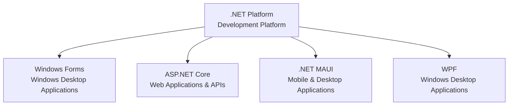

# .NET Platform and Frameworks

## What Is the Difference Between a Platform and a Framework?

- **Platform:** A broader environment that provides the runtime, libraries, and development tools needed to build and run applications.
- **Framework:** A set of reusable components and conventions that helps developers build a particular type of application.

**.NET is a development platform.** It supports several frameworks for different types of applications.

## .NET Platform Diagram

## Key Takeaway

**.NET is the platform; Windows Forms, ASP.NET Core, .NET MAUI, and WPF are frameworks used to build applications with .NET.**
