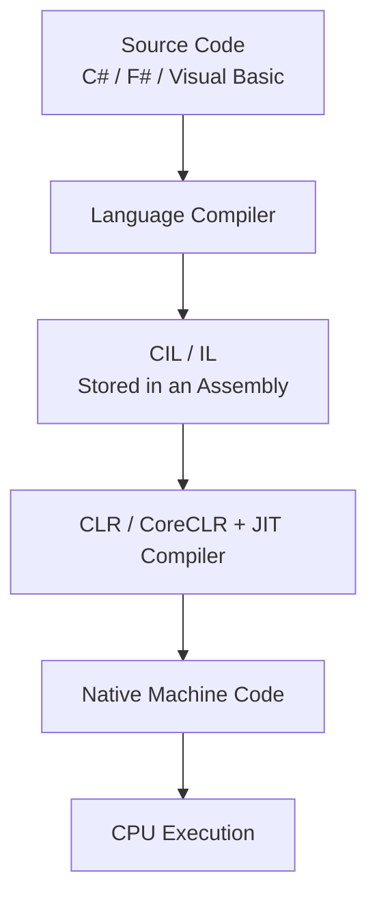
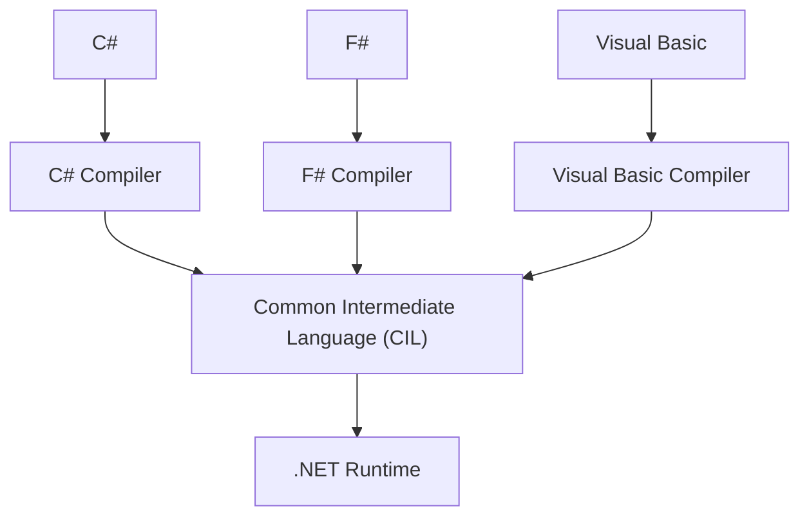
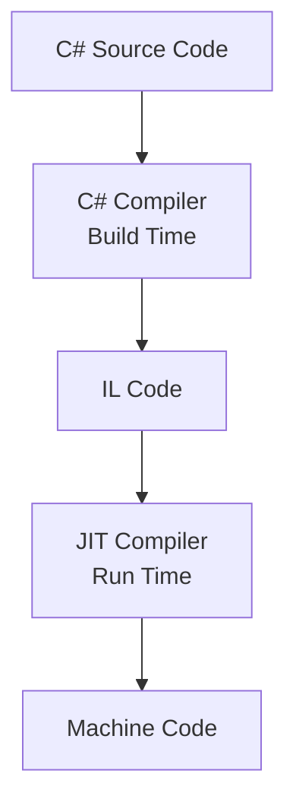
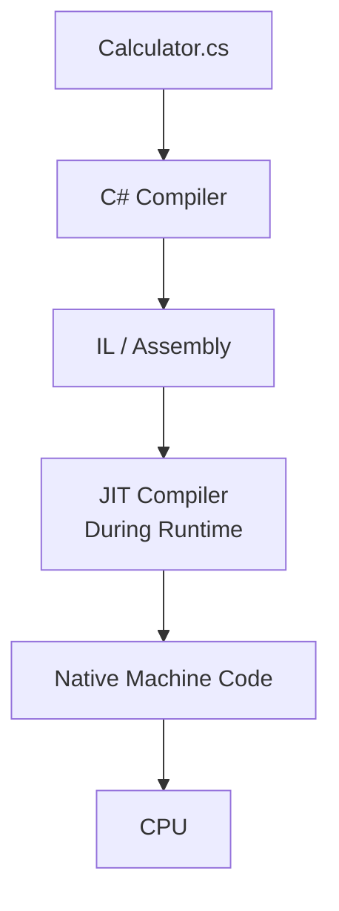
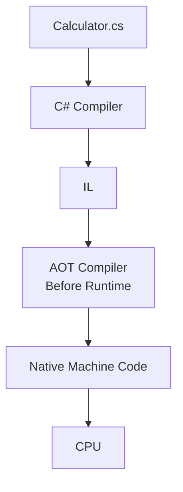
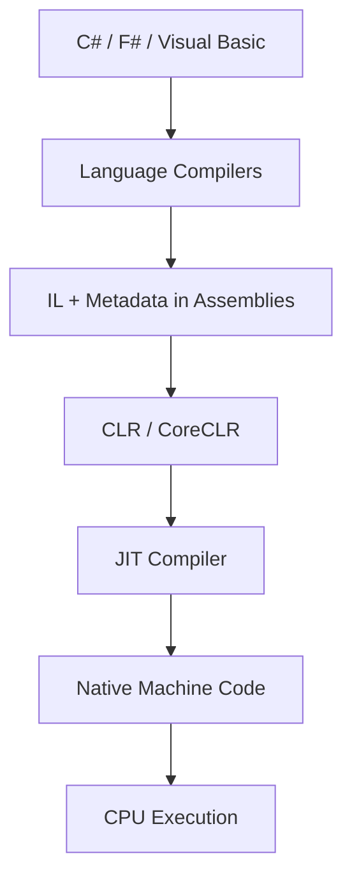

# 💻 Compilation in .NET — From C# Source Code to Machine Code

Compilation in .NET involves several related concepts: **Compiler, IL, Assembly, CLR, JIT, and AOT**.

The goal is to understand **why each component is needed**, rather than simply memorizing definitions.

---

## 1. What Is Compilation?

**Compilation** is the process of translating program code from one representation into another.

We write applications using programming languages such as C#, C++, or Java. However, a computer's processor (**CPU**) cannot execute C# source code directly. It executes **machine instructions** designed for its processor architecture.

For example:

```csharp
int x = 10;
int y = 20;

Console.WriteLine(x + y);
```

**Output:**

```text
30
```

You understand that the program adds two numbers and prints the result. But how does the computer execute these instructions?

That is where a **compiler** comes in.

### What Is a Compiler?

A **compiler** is a program that translates code from one representation into another.

In some programming environments, a compiler translates source code directly into machine code. In the **usual .NET compilation process**, however, there is an intermediate step called **IL (Intermediate Language)**.

---

## 2. How Does Compilation Work in .NET?

The typical .NET execution process using **JIT compilation** looks like this:



This is the **usual JIT path**. We will examine AOT later.

### Stage 1: Writing Source Code

You write C# code in an editor such as Visual Studio:

```csharp
static int Add(int a, int b)
{
    return a + b;
}
```

This is called **source code**: the human-readable code written by the programmer.

The CPU does not directly execute this C# text.

### Stage 2: Translating Source Code into IL

When you **build** a C# project, the C# compiler (the Roslyn C# compiler in modern .NET) normally translates your C# code into **IL**.

**IL** stands for **Intermediate Language**. It is an intermediate representation between a high-level programming language and machine instructions.

You may encounter three related names:

- **IL** — Intermediate Language.
- **CIL** — Common Intermediate Language.
- **MSIL** — Microsoft Intermediate Language (a historical term).

For this lesson, these names refer to the same basic concept.

#### Why Doesn't .NET Always Compile C# Directly to Machine Code?

One major advantage of IL is that different .NET languages can compile into a **common intermediate format**.



- The **C# compiler** compiles C# code.
- The **F# compiler** compiles F# code.
- The **Visual Basic compiler** compiles Visual Basic code.

All three can produce IL that a compatible .NET runtime understands.

This is what **language-agnostic** means in the instructor's slide: IL is not tied to a single source programming language.

#### What Does IL Look Like?

Consider this C# method:

```csharp
static int Add(int a, int b)
{
    return a + b;
}
```

Its essential IL instructions might look like this:

```il
ldarg.0
ldarg.1
add
ret
```

| Instruction | Meaning |
|---|---|
| `ldarg.0` | Load the first argument. |
| `ldarg.1` | Load the second argument. |
| `add` | Add the two values. |
| `ret` | Return the result. |

This is a simplified excerpt, not a complete assembly.

**Important:** IL is **not C# source code**, and it is **not machine code for one particular CPU architecture**.

### Stage 3: Storing IL in an Assembly

After compilation, IL is typically stored in a file called an **assembly**.

An assembly may have a filename such as:

- `Program.dll`
- `Program.exe`

An assembly usually contains more than IL instructions. It also contains information that describes the program.

```text
Program.dll
│
├── IL Code       → Intermediate program instructions
├── Metadata      → Information about types and methods
└── Manifest      → Information describing the assembly
```

A `.exe` extension does **not always mean** that every instruction inside the file is already native machine code. For example, a .NET Framework `.exe` can contain IL.

In modern .NET, an application often has a `Program.dll` containing IL along with a launcher or host executable.

#### What Have We Learned So Far?

When you write and build a typical C# application:

```text
C# Source Code
    ↓
C# Compiler
    ↓
IL (Intermediate Language)
    ↓
Assembly (.dll or .exe)
```

At this point, the application has **not necessarily been translated into the final native machine code** that the CPU will execute.

That brings us to the **CLR** and **JIT**.

---

## 3. What Is the CLR, and Why Do We Need It?

**CLR = Common Language Runtime**.

The CLR is the runtime environment responsible for providing services needed to execute **managed .NET code**.

Imagine that you have completed your application, clicked **Build**, and produced an assembly containing IL. Now you want to run it.

The CLR helps manage that execution.

### Main CLR Responsibilities

| Responsibility | Explanation |
|---|---|
| **JIT Compilation** | Translates IL into native machine code when needed. |
| **Memory Management** | Helps manage memory used by the application. |
| **Garbage Collection (GC)** | Reclaims memory from managed objects that are no longer reachable. |
| **Exception Handling** | Supports handling exceptions and runtime errors. |
| **Type Safety** | Helps enforce safe and consistent handling of data types. |

The CLR does **more than compile code**: it provides services that support the program while it runs.

> **Terminology:** The runtime in .NET Framework is commonly called the **CLR**. The main runtime implementation used by modern .NET is called **CoreCLR**. Many fundamental concepts apply to both.

### How Does the CLR Run a C# Application?

For a typical application using JIT compilation, the runtime loads the required assemblies, prepares the needed types and methods, and uses JIT to produce native machine code.

```text
Program.dll
    ↓
CLR / CoreCLR
    ↓
JIT Compiler
    ↓
Native Machine Code
    ↓
CPU
```

This raises an important question:

**Why do we need a JIT compiler if we already used the C# compiler?**

Because the two compilers have **different jobs**.

---

## 4. C# Compiler vs. JIT Compiler

In the usual JIT-based .NET compilation process, two different translations take place.

### C# Compiler

- **Input:** C# source code.
- **Output:** IL.
- **When:** Usually at **build time**, before the application starts.

### JIT Compiler

- **Input:** IL.
- **Output:** Native machine code.
- **When:** During **runtime**, when native code for a method is needed.



This is not redundant work. Each compiler converts a different representation into another one.

---

## 5. What Is JIT (Just-In-Time Compilation)?

**JIT = Just-In-Time Compilation**.

JIT is the process of compiling IL into native machine code **during execution, when the code is needed**.

Instead of having to compile every method into native code beforehand, the runtime can compile methods as they become necessary.

### Practical Example

```csharp
class Program
{
    static void Main()
    {
        SayHello();
        Add(10, 20);
    }

    static void SayHello()
    {
        Console.WriteLine("Hello!");
    }

    static int Add(int a, int b)
    {
        return a + b;
    }

    static void UnusedMethod()
    {
        Console.WriteLine("Never called!");
    }
}
```

The program contains four methods:

1. `Main()`
2. `SayHello()`
3. `Add()`
4. `UnusedMethod()`

Notice that **`UnusedMethod()` is never called**.

### What Happens During Build?

The C# compiler produces IL for the application and stores it in an assembly.

This does not require every method to already have its own native machine code.

### What Happens During Run?

In a simplified model:

1. **`Main()`** — The runtime gets the native code it needs to begin executing `Main()`.
2. **`SayHello()`** — When the method is needed, JIT may compile it into native machine code, then execute it.
3. **`Add()`** — When needed, JIT may compile it and then execute the addition.
4. **`UnusedMethod()`** — Since this method is never called, it may never need to be JIT-compiled.

> **Note:** This is a simplified educational model. Optimizations such as **inlining** and **tiered compilation** can change exactly when or how methods are compiled.

### Does JIT Recompile a Method Every Time It Is Called?

**Usually, no.**

Consider:

```csharp
Console.WriteLine(Add(10, 20));
Console.WriteLine(Add(30, 40));
Console.WriteLine(Add(50, 60));
```

In the typical case:

1. JIT compiles `Add()` when native code is first needed.
2. The runtime keeps the resulting machine code in the process's memory.
3. Later calls can reuse that compiled code.

So **JIT does not normally recompile a method from scratch for every call**.

However, with **tiered compilation**, .NET may compile some methods again later to produce more optimized versions.

### Why Is JIT Useful?

JIT can:

- Compile methods **when needed** instead of compiling everything in advance.
- Generate machine code suitable for the current processor and runtime environment.
- Apply runtime-specific performance optimizations.
- Avoid compiling some methods that are never executed.

### Is JIT Always Fast?

It is important to distinguish **compilation time** from **execution performance**.

JIT has a compilation cost while the application runs, especially when some methods are used for the first time. This may affect startup time.

But JIT can also perform strong optimizations and deliver excellent performance while the application continues running.

**Remember:** JIT translates IL into native machine code **when needed at runtime**.

---

## 6. What Is AOT (Ahead-of-Time Compilation)?

**AOT = Ahead-of-Time Compilation**.

AOT means producing native machine code **before the application starts running**.

Instead of waiting for runtime to compile IL, compilation happens earlier—usually as part of the build or publishing process.

### Comparing the Compilation Paths

#### JIT Path



In this case, some compilation happens **while the application is running**.

#### AOT Path



In this case, native machine code is produced **before execution**.

### Benefits of AOT

Depending on the technology and application, AOT may provide:

- Faster **startup time**.
- Reduced or eliminated **JIT compilation at runtime**.
- Lower runtime compilation overhead.
- Deployment without requiring a separately installed .NET runtime, as with **self-contained Native AOT** applications.

However, AOT does **not guarantee** better performance for every application.

JIT can sometimes take advantage of runtime information to optimize code in ways that AOT cannot.

### Why Is AOT Useful for Mobile Applications?

Mobile applications often need to start quickly. Some operating systems also restrict generating and executing new machine code at runtime.

Therefore, AOT is useful in certain mobile scenarios, particularly on **iOS**.

It is also useful for some command-line tools, services, and resource-constrained devices.

### What Is NGen.exe?

The instructor mentions **Native Image Generator (`NGen.exe`)**.

NGen is an older tool associated with **.NET Framework**. It creates native images from assemblies ahead of time, which can reduce some JIT work.

Modern .NET uses different technologies, including:

- **ReadyToRun (R2R):** Includes precompiled native code but may still use JIT in certain situations.
- **Native AOT:** Publishes an application as native machine code, without relying on the usual JIT compilation path for application code.

So **NGen is not the standard AOT tool for all versions of .NET**.

Also, compiling with Native AOT does **not eliminate every runtime service**. The application still needs facilities such as memory management and garbage collection; necessary runtime components can be included with the published application instead of requiring a separate runtime installation.

---

## 7. JIT vs. AOT — Key Differences

| Comparison | JIT | AOT |
|---|---|---|
| Full name | Just-In-Time | Ahead-of-Time |
| When native code is generated | During execution | Before execution |
| Needs JIT at runtime? | Usually yes | Depends on the AOT technology |
| Startup time | May include compilation overhead | Often faster |
| Runtime-specific optimization | Very flexible | Depends on build and deployment choices |
| Target processor | Can be determined at runtime | Usually chosen at build time |
| Example | CoreCLR JIT | Native AOT |

### A Simple Real-Life Analogy

Imagine you have a book written in English, but you only understand Arabic.

**JIT — Translate While Reading**

You start reading. Whenever you reach a new paragraph, you translate it into Arabic and then read it. You only translate what you need, and you can reuse translations you have already made.

**AOT — Translate Before Reading**

You translate the book into Arabic **before** you start reading it. The preparation takes time, but you can then read without having to translate each paragraph as you go.

> This analogy illustrates **when compilation happens**. It does not describe every technical detail of the .NET runtime.

---

## 8. Understanding the CLR Execution Model

The final diagram in the lesson combines the concepts we discussed:

- Source code and language compilers.
- IL assemblies and managed code.
- CLR and JIT compilation.
- Native machine code and the operating system.
- Unmanaged components.

Let's examine each part.

### Part 1: Source Code

The top of the diagram shows languages such as:

- C#
- VB.NET
- C++ .NET

Each language has an appropriate compiler.

**Note:** **C++/CLI** can produce managed or mixed managed/native code, so it is more flexible than a simple one-language-to-one-runtime diagram suggests.

### Part 2: Managed Code and IL Assemblies

After compilation, .NET languages can produce IL stored in assemblies.

This introduces an important term: **managed code**.

#### What Is Managed Code?

Managed code is code whose execution is managed by the .NET runtime, which provides services such as memory management and garbage collection.

For example:

```csharp
Person person = new Person();
```

When you create an object, the runtime helps manage its memory.

When the object is no longer reachable by the running program, the **Garbage Collector** may reclaim the memory it occupied.

**Managed** does not mean the CLR writes your code for you. It means the runtime provides services to support the execution of that code.

### Part 3: CLR and JIT

Assemblies are loaded by the runtime. In the usual JIT execution path, JIT translates the IL needed by the application into native code.

This is the same process discussed in the earlier sections.

### Part 4: Native Code, Operating System, and CPU

After native compilation, the program has instructions suitable for the target architecture, such as:

- **x64**
- **ARM64**

Each processor architecture has its own instruction set.

The operating system (Windows, Linux, etc.) supplies the environment in which the process runs and manages resources such as files, memory, and scheduling.

The **CPU physically executes native machine instructions**, under the operating system's management.

### Part 5: Unmanaged Components

The final diagram also includes an **unmanaged component**.

#### What Is Unmanaged Code?

Unmanaged code is code whose execution is not managed by the CLR in the same way as managed .NET code.

A common example is a **native library written in C or C++**, which is already compiled into native machine code.

A .NET application can call such libraries through mechanisms such as **P/Invoke**.

| Managed Code | Unmanaged Code |
|---|---|
| Execution is managed by the .NET runtime. | Execution is not managed by the CLR in the same way. |
| Managed objects benefit from garbage collection. | Memory may require manual management or other mechanisms. |
| Example: Typical C# code. | Example: A native C++ DLL. |

This comparison does **not mean** managed code is always faster or slower than unmanaged code. It also does not mean C++ cannot interact with .NET.

### Complete CLR Execution Diagram



Again, this shows the **typical JIT-based execution path**. With AOT, IL can be compiled to native machine code ahead of execution, without following the same runtime JIT step.

---

## 9. Two Important Clarifications About the Instructor's Slides

### Clarification 1: Are JIT and AOT Two Consecutive Required Stages?

The slide describes **JIT** and **AOT** under two compilation stages.

Technically, **JIT and AOT are different approaches to producing native machine code**. They are not two mandatory, consecutive stages that every .NET program passes through.

An application may use:

- **JIT**.
- **Native AOT**.
- A **combination**, such as ReadyToRun with some JIT compilation.

In the ordinary **JIT-based** path, the two translations to remember are:

1. **C# Compiler:** C# source code → IL.
2. **JIT Compiler:** IL → native machine code.

### Clarification 2: Is AOT Always Faster Than JIT?

**Not necessarily.**

AOT can improve startup time by reducing compilation work during execution. But the speed of the application after startup depends on many factors.

JIT can apply runtime-specific optimizations, while AOT can avoid certain runtime costs.

Therefore, **neither approach is automatically best for every application**.

---

## 10. Final Review — Key Terms

| Term | Meaning |
|---|---|
| **Source Code** | Human-readable code written in a language such as C#. |
| **C# Compiler** | Translates C# source code into IL. |
| **IL / CIL** | A common intermediate language used in .NET. |
| **Assembly** | A file containing IL and metadata. |
| **CLR** | Runtime environment that manages the execution of .NET applications. |
| **JIT** | Translates IL into native code as needed during execution. |
| **AOT** | Produces native code before execution. |
| **Machine Code** | Native instructions executed by the CPU. |
| **Managed Code** | Code whose execution is managed by the .NET runtime. |
| **Unmanaged Code** | Code not managed by the CLR in the same way. |

### Final Example: StudentManager

Imagine you create an application called **StudentManager** in C#.

You write:

```csharp
Console.WriteLine("Welcome to Student Manager");
```

Then you click **Build** in Visual Studio.

1. The **C# compiler** translates your source code into **IL**.
2. The IL is stored in an **assembly**.
3. When you click **Run**, the .NET runtime starts the application.
4. If the application uses **JIT**, the required IL is compiled into native machine code during execution.
5. The **CPU** executes the instructions, and the message appears on the screen.

If you publish the application with **Native AOT**, native machine code is instead produced **before the application runs**.

---

## 🧠 Check Your Understanding

Try answering these questions before looking at the answers.

**Question 1:** When you click Build on a typical C# project, what does the C# compiler produce?

- A. Machine code directly in every case.
- B. IL / CIL.
- C. F# source code.

**Question 2:** When does JIT compilation take place?

- A. While you are writing the code.
- B. During application execution, when needed.
- C. Only when you save the source file.

**Question 3:** What is the main idea behind AOT?

- A. Produce native machine code before execution.
- B. Translate every line only when printing output.
- C. Avoid using C# as a programming language.

<details>
<summary>✅ Show Answers and Explanations</summary>

1. **B — IL / CIL.** In the normal build process, the C# compiler translates C# code into IL and stores it in an assembly.
2. **B — During execution, when needed.** JIT translates IL into native code when the runtime needs to execute it.
3. **A — Produce native machine code before execution.** AOT performs native compilation ahead of runtime rather than relying entirely on JIT at execution time.

</details>

---

## ⭐ Most Important Concept

In the **usual JIT-based .NET compilation process**, C# code goes through **two different translations**:

1. **C# → IL** during the build process.
2. **IL → Native Machine Code** during execution using JIT.

With **AOT**, native machine code is generated **before** the application runs.

Once you understand these relationships, it becomes much easier to study **CLR, Garbage Collection, Assemblies, and the internal architecture of .NET**.

---

### 🌐 Translations

[](https://github.com/user-attachments/files/33570211/04_compilation_in_.NET_AR.pdf)
