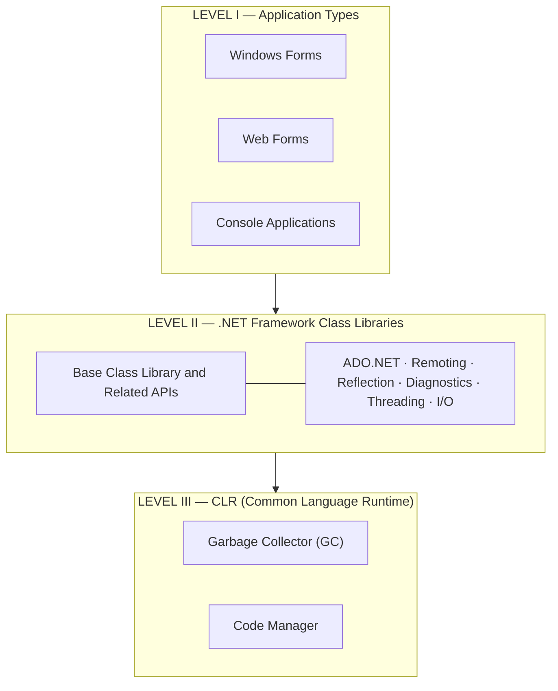
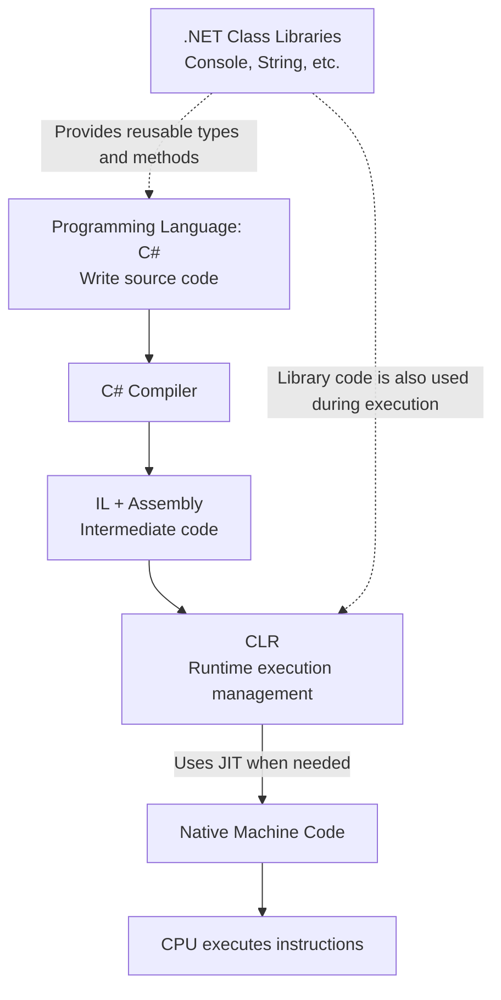

# 💻 Architecture of .NET Framework

**Architecture** refers to the internal structure of a system.

When we talk about **.NET Framework Architecture**, we want to understand:

- How is .NET Framework structured?
- What components does it contain?
- How do these components work together to run C# applications?

According to the instructor, .NET Framework has **two major components**:

1. **CLR (Common Language Runtime)** — The environment that runs applications.
2. **Class Library** — Ready-to-use classes, APIs, and programming tools.

Another important part is the **Programming Languages**, such as C# and Visual Basic.

---

## 1. Understanding the Architecture Diagram

The instructor's diagram is divided into **three levels: I, II, and III**.



The basic idea is:

- **Level I:** The applications we build.
- **Level II:** The libraries and APIs those applications use.
- **Level III:** The runtime that helps execute and manage the applications.

> **Important:** This is a simplified *architectural diagram*, not a literal sequence that every line of code passes through. It shows how the components are related.

---

## 2. Level I — Application Types

This level shows the types of applications we can build with **.NET Framework**.

The image includes three application types.

### 🖥️ A. Windows Forms

**Windows Forms** is a technology for building Windows desktop applications with a **GUI (Graphical User Interface)**.

For example, you could create a student management application with buttons, text boxes, and tables.

The diagram mentions:

- **Controls:** Ready-made user-interface elements such as `Button`, `TextBox`, and `Label`.
- **Drawing:** Features for drawing shapes, lines, and graphics.
- **Windows Application:** The final application that runs on Windows.

**Example — Responding to a button click:**

```csharp
private void button1_Click(object sender, EventArgs e)
{
    MessageBox.Show("Hello!");
}
```

Here, you use Windows Forms to provide the button, the message box, and the event system.

You do not need to build all those features from scratch.

### 🌐 B. Web Forms

**Web Forms** is an older technology within **ASP.NET on .NET Framework** for building web applications.

The image includes these concepts:

| Component | Purpose |
|---|---|
| **Web Controls** | Ready-made controls for building web-page interfaces. |
| **Server** | Receives requests and processes them. |
| **Client** | The user's device or web browser. |
| **Web Services** | Services that allow communication and data exchange. |

**Example:** Imagine building a student registration website.

1. A user enters their name in a web browser.
2. The browser sends the information to the server.
3. The server processes the data and can save it to a database.

This is an example of how the **Client** and **Server** cooperate.

> **Note:** Web Forms belongs to the traditional .NET Framework ecosystem. Modern .NET web applications are usually developed with **ASP.NET Core**.

### ⌨️ C. Console Applications

**Console Applications** interact with users mainly through text rather than graphical controls such as buttons and windows.

**Example:**

```csharp
Console.WriteLine("Enter your name:");

string name = Console.ReadLine();

Console.WriteLine("Hello " + name);
```

**Output:**

```text
Enter your name:
Mohammed
Hello Mohammed
```

Console applications are often used when learning the fundamentals of C#.

### What Do These Application Types Have in Common?

Although their user interfaces are different, all three can use **.NET Framework libraries** and the **CLR** to run managed code.

---

## 3. Level II — Base Class Library (BCL)

One of the most important concepts in this lesson is the **BCL**.

**BCL = Base Class Library**

It provides basic, ready-to-use types and functionality for common programming tasks.

Instead of implementing everything from scratch, you can use functionality provided by .NET.

### 💡 Simple Example

Imagine you want to calculate the square root of 25:

```csharp
double result = Math.Sqrt(25);

Console.WriteLine(result);
```

**Output:**

```text
5
```

Where does `Math.Sqrt()` come from?

It is provided by the .NET class libraries.

You do not have to write your own square-root algorithm; you use existing functionality.

### Understanding the Six Library Areas in the Diagram

#### 1. 🗄️ ADO.NET — Database Access

**ADO.NET** provides tools for accessing databases, executing queries, and reading or updating data.

**Example:** A student management application stores students' names and grades in a SQL Server database.

#### 2. 🌐 Remoting — Communication Between Applications

**.NET Remoting** is an older technology that lets objects in different processes or computers communicate with one another.

**Example:** An application requests an operation from another application running on a different computer.

> **Note:** .NET Remoting is a legacy .NET Framework technology and is not a typical choice in modern .NET applications.

#### 3. 🔎 Reflection — Inspecting Types and Code

**Reflection** allows a program to discover information about classes, methods, and properties at runtime.

**Example — Getting the name of a type:**

```csharp
Type type = typeof(string);

Console.WriteLine(type.Name);
```

**Output:**

```text
String
```

#### 4. 📊 Diagnostics — Monitoring and Troubleshooting

**Diagnostics** provides tools for monitoring an application, measuring performance, and gathering information to help identify problems.

**Example:** Using `Stopwatch` to measure how long an operation takes.

#### 5. 🧵 Threading — Managing Threads

**Threading** allows a program to organize multiple threads of execution and coordinate work.

**Example:** Performing a lengthy calculation without freezing a desktop application's user interface, when execution is organized correctly.

#### 6. 📁 I/O — Input / Output

**I/O** stands for **Input / Output**.

It includes activities such as reading files and writing data to files.

**Example:**

```csharp
File.WriteAllText("note.txt", "Hello!");
```

This creates a text file (or replaces its contents) with `Hello!`.

### BCL vs. FCL — A Small but Important Distinction

The instructor's diagram groups several library areas under **BCL** to illustrate the general role of libraries.

However, in .NET Framework, there is also a broader term:

**FCL = Framework Class Library**

The FCL includes the fundamental class libraries as well as additional frameworks and APIs, such as libraries for database access and user interfaces.

Therefore, not every area shown in the diagram should be treated as part of the BCL in the narrow technical sense.

**Key idea:** Class libraries provide reusable functionality that different application types can use.

---

## 4. Level III — CLR (Common Language Runtime)

**CLR = Common Language Runtime**

The CLR is the runtime engine responsible for executing **Managed Code** and providing services that support its execution.

Imagine you have created a C# program and used libraries such as `Console` and `Math`.

After the C# compiler converts your source code into **IL (Intermediate Language)**, the program needs a runtime environment to execute the instructions.

That is where the **CLR** comes in.

### A. Garbage Collector (GC)

The **Garbage Collector** helps manage memory by reclaiming memory occupied by managed objects that are no longer reachable.

**Example:**

```csharp
class Student
{
    public string Name;
}
```

Then:

```csharp
Student s1 = new Student();

s1.Name = "Ali";

s1 = null;
```

What happened?

1. We created an object of type `Student`.
2. We stored a student's name in it.
3. We changed `s1` so that it no longer refers to that object.

If no other references can reach the object, it becomes **eligible for garbage collection**.

**Is it deleted immediately?** No.

The GC decides when to collect unreachable objects and reclaim their memory.

This reduces much of the manual memory-management work that programmers might otherwise have to do in a language such as C++.

### B. Code Manager

The instructor's diagram also shows a **Code Manager** as part of the CLR.

It is related to managing the information needed to work with code during execution, such as information about compiled methods and support for runtime services.

However, the **Code Manager is not the same as the JIT Compiler**.

- **JIT Compiler:** Translates IL into native machine code when needed.
- **Code Manager:** Helps the runtime work with information about native code that is being executed.

You do not need to memorize the internal details of the Code Manager yet. For now, understand that it is part of the CLR's execution-management mechanisms.

### Does the CLR Do Anything Else?

Yes. The instructor also mentions these runtime services:

| CLR Service | Purpose |
|---|---|
| **Thread Management** | Supports and coordinates threads of execution. |
| **Garbage Collection** | Reclaims memory from unreachable managed objects. |
| **Type Safety** | Helps enforce safe use of types. |
| **Exception Handling** | Supports handling errors and exceptions at runtime. |
| **JIT Compilation** | Converts IL into native machine code during execution. |

---

## 5. Where Do Programming Languages Fit?

At the end, the instructor says:

> Another important component is: Languages.

This refers to the programming languages supported by the .NET Framework ecosystem, such as:

- **C#**
- **Visual Basic**
- **F#**

We use these languages to write **Source Code**.

Each language has its own compiler that can produce **IL**.

This connects today's lesson to the previous topic: **Compilation in .NET**.

### How Do All These Components Work Together?

Imagine you created a simple Console application:

```csharp
using System;

class Program
{
    static void Main()
    {
        string name = "Ali";

        Console.WriteLine("Hello " + name);
    }
}
```

Let's follow the execution process:



What happens?

1. **C#** is the language used to write the code.
2. The **C# Compiler** converts the source code into IL stored in an assembly.
3. The **CLR** loads and executes the managed program and provides runtime services.
4. In the usual **JIT execution path**, IL is translated into native machine code.
5. The **CPU** executes machine instructions.

At the same time, the program uses .NET library functionality such as `System.String` and `Console`.

> This is the usual JIT execution path. The original architecture diagram describes the *components* of the system, while this diagram shows a simplified *execution process*.

---

## 6. CLR vs. BCL — The Most Important Difference

These are the two main components emphasized by the instructor.

| CLR | BCL |
|---|---|
| **Common Language Runtime** | **Base Class Library** |
| Runtime environment | Ready-made libraries and types |
| Helps execute the application | Provides functionality used by the application |
| Manages memory through the GC | Provides tools for text, files, and other tasks |
| Supports JIT and exception handling | Provides types such as `String`, `DateTime`, and `List<T>` |

### 💡 Easy Example to Remember

When you write:

```csharp
Console.WriteLine("Hello World!");
```

- **C#:** The programming language used to write the instruction.
- **Class Library:** Provides `Console.WriteLine()`.
- **CLR:** Helps run the application and manage code execution.
- **CPU:** Executes the resulting machine instructions.

---

## 🎯 Final Summary

Remember **.NET Framework Architecture** this way:

- **Programming Languages →** Used to write programs.
- **Application Frameworks →** Help us build particular application types, such as Windows Forms and Web Forms.
- **Class Library →** Provides ready-to-use libraries and functionality.
- **CLR →** Provides the runtime environment and execution-management services.

All these components cooperate to build and run .NET Framework applications.

> **Final note:** The diagram describes the *traditional .NET Framework* architecture, so it includes legacy technologies such as Web Forms and Remoting. Many fundamental ideas — such as class libraries, CLR, GC, and JIT — are still important for understanding modern .NET.

### 🧠 Quick Question

When you write `Math.Sqrt(25)`, which component provides the method: **BCL** or **CLR**? **Why?**

---

### 🌐 Translations

[](https://github.com/user-attachments/files/33605960/01_.NET_framework_architecture_AR.pdf)
