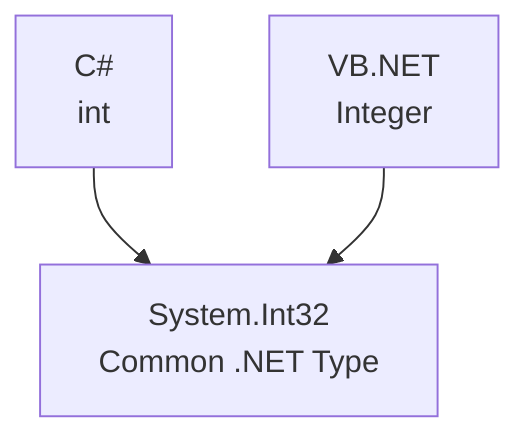

# 💻 Common Type System (CTS)

**CTS = Common Type System**

The **Common Type System (CTS)** is a system within .NET that defines rules for **declaring, using, and managing data types at runtime**.

But why do we need CTS, and what problem does it solve?

Let's understand it step by step.

---

## 1. What Problem Does CTS Solve?

As we learned earlier, the .NET platform supports multiple programming languages, such as:

- C#
- Visual Basic (VB.NET)
- F#

However, different languages may use different names for their data types.

For example, suppose we want to declare a variable that stores an integer.

**In C#:**

```csharp
int age = 21;
```

**In VB.NET:**

```vb
Dim age As Integer = 21
```

Notice the difference:

- C# uses `int`.
- VB.NET uses `Integer`.

**How can .NET work with both types even though their names are different?**

This is where **CTS** comes in.

---

## 2. How Does CTS Solve This Problem?

CTS defines a common type system that .NET languages can use.

In the previous example, both `int` in C# and `Integer` in VB.NET refer to the same .NET type:

**`System.Int32`**



Even though the type names differ between programming languages, they can use the **same common .NET type**.

---

## 3. Examples of Common Data Types

| C# | VB.NET | .NET Type |
|---|---|---|
| `int` | `Integer` | `System.Int32` |
| `long` | `Long` | `System.Int64` |
| `short` | `Short` | `System.Int16` |
| `bool` | `Boolean` | `System.Boolean` |
| `string` | `String` | `System.String` |
| `double` | `Double` | `System.Double` |

This means that data types written using different .NET languages can refer to the same underlying types provided by .NET.

---

## 4. What Does Cross-Language Communication Mean?

**Cross-language communication** means that components written in different programming languages can work together.

For example, imagine that you create a library using C# and want to use it in a VB.NET application.

Because the two languages share the .NET type system, they can exchange data using compatible types.

If a C# library has a method that accepts an `int`, a VB.NET application can pass an `Integer` value to it because both use **`System.Int32`**.

This is one of the important benefits of CTS.

---

## 5. What Does Language-Independent Code Mean?

It means that code and libraries can use common data types without being limited to a single programming language.

**It does not mean that you can copy C# syntax directly into a VB.NET program.** Rather, both languages can use shared .NET types and components.

---

## 🎯 Summary

**Common Type System (CTS)** defines common rules for data types in .NET and helps different .NET languages work with those types consistently.

Remember this example:

```text
C# int          ─┐
                 ├──> System.Int32
VB.NET Integer ─┘
```

**Most important point:** CTS does not compile C# code. It defines a unified type system used by .NET languages, making it easier to share data and libraries between them.

---

### 🌐 Translations

[](https://github.com/user-attachments/files/33626926/03_common_type_system_CTS_AR.pdf)
