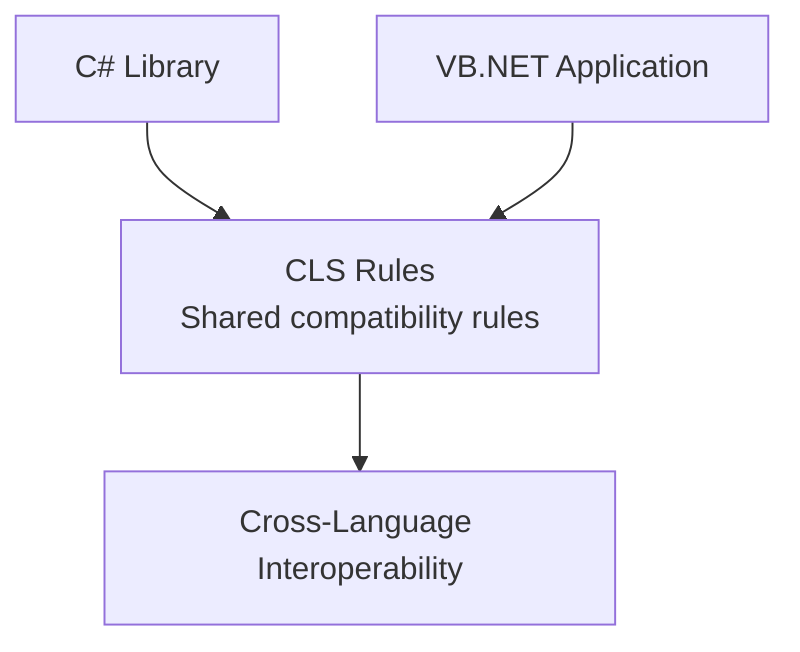

# 💻 Common Language Specification (CLS)

**CLS = Common Language Specification**

The Common Language Specification (CLS) is a set of rules and standards within the .NET platform that helps different programming languages, such as **C#**, **VB.NET**, and **F#**, work together and share components reliably.

But why do we need CLS if we already have CTS? Let's understand it step by step.

---

## 1. What Problem Does CLS Solve?

As we learned earlier, .NET supports multiple programming languages. However, **each language has its own syntax and features**.

For example, let's create a method that adds two numbers.

**In C#:**

```csharp
public int Add(int a, int b)
{
    return a + b;
}
```

**In VB.NET:**

```vb
Public Function Add(a As Integer, b As Integer) As Integer
    Return a + b
End Function
```

Notice that the syntax is different, but the purpose is the same.

Now imagine that you create a library in **C#** and want someone writing **VB.NET** to use it.

**How can we make sure components written in C# can be used from VB.NET?**

This is where **CLS** comes in.

---

## 2. How Does CLS Solve This Problem?

CLS defines a common set of rules that .NET languages can support.

When a library follows these rules in the parts it exposes to other programs, it becomes easier to use that library from different .NET languages.



**Important:** CLS does not make every programming language use the same syntax. It defines rules that help different languages interoperate when sharing components.

---

## 3. Practical Example of CLS

Imagine creating a library in **C#** that contains this class:

```csharp
public class Calculator
{
    public int Add(int a, int b)
    {
        return a + b;
    }
}
```

Then create an application in **VB.NET** and add a reference to the C# library.

You can use the method like this:

```vb
Dim calc As New Calculator()

Dim result As Integer = calc.Add(10, 20)

Console.WriteLine(result)
```

**Output:**

```text
30
```

What happened here?

1. We created the library using **C#**.
2. We used the library inside a **VB.NET** application.
3. The application was able to use the method and its data types.

This is possible because .NET provides a common type system and the library's public interface uses elements compatible with CLS.

### Is Everything in C# CLS-Compliant?

**No, and this is very important.**

For example, C# supports the `uint` data type:

```csharp
uint number = 100;
```

But `uint`, which represents `System.UInt32`, is **not CLS-compliant**.

Therefore, a public method like this has a non-CLS-compliant interface:

```csharp
public uint GetNumber()
{
    return 100;
}
```

On the other hand, this method uses the CLS-compliant `int` type:

```csharp
public int GetNumber()
{
    return 100;
}
```

**Why?** Because CLS defines a common subset of features that different languages can be expected to support.

This does **not** mean that `uint` is forbidden in C#. You can use it in your program. However, when designing a public API to be shared with other languages, it is best to follow CLS rules.

---

## 4. What Does Cross-Language Inheritance Mean?

**Cross-Language Inheritance** means inheriting from classes written in a different .NET language.

Imagine creating a class in **C#**:

```csharp
public class Person
{
    public string Name { get; set; }
}
```

Then you create another class using **VB.NET** that inherits from it:

```vb
Public Class Student
    Inherits Person
End Class
```

Here, the `Student` class written in VB.NET inherits from the `Person` class written in C#, provided the referenced library is available and the relevant access and compatibility rules are satisfied.

This demonstrates how .NET languages can share classes and support inheritance across language boundaries.

---

## 5. What Does Cross-Language Debugging Mean?

**Cross-Language Debugging** means being able to trace and debug execution across components written in different programming languages.

For example, imagine a **VB.NET** application that calls a method from a **C#** library.

If an error occurs in that library, debugging tools that support both languages may allow you to trace execution between the components, provided the necessary debugging information and settings are available.

**Important:** CLS does not perform debugging itself. This capability also depends on the CLR, development tools, and debugging information.

---

## 6. What Is the Difference Between CTS and CLS?

Since we previously studied CTS, it is important to understand the difference.

| CTS | CLS |
|---|---|
| **Common Type System** | **Common Language Specification** |
| The common system of data types | The common language specification |
| Defines data types and the rules for using them | Defines rules that promote interoperability between languages |
| Example: `System.Int32` | Example: using data types and public APIs supported by compliant languages |
| Has a broader scope | Defines a more restrictive subset of CTS rules |

### Example

**CTS tells us that:**

- `int` in C# and `Integer` in VB.NET both represent the common type `System.Int32`.

**CLS tells us that:**

- We should follow certain rules when designing public library interfaces so different .NET languages can use them.

**In short: CTS is concerned with the type system, while CLS is concerned with the shared rules for interoperability between languages.**

---

## 🎯 Final Summary

**Common Language Specification (CLS)** is a set of rules that helps different .NET languages work together.

Its main benefits include:

1. **Language Interoperability:** Making it easier to use components across different programming languages.
2. **Cross-Language Inheritance:** Supporting inheritance between classes written in different languages.
3. **Consistent Public APIs:** Helping developers build public library interfaces that can be used from multiple languages.

CLS rules can also help teams work on multi-language projects, although debugging relies on additional tools and runtime services.

### Remember This Difference

- **CTS:** What common data types and type rules does .NET provide?
- **CLS:** What rules should we follow so different .NET languages can use our libraries?

> **Final Note:** Not every feature or internal detail of C# must follow CLS. CLS compatibility is particularly important for the **public APIs** you want to share with other languages.

---

### 🌐 Translations

[](https://github.com/user-attachments/files/33627460/04_common_language_specification_CLS_AR.pdf)
