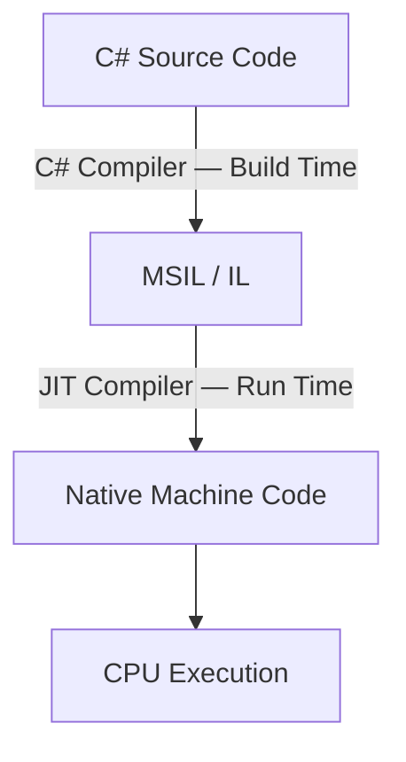
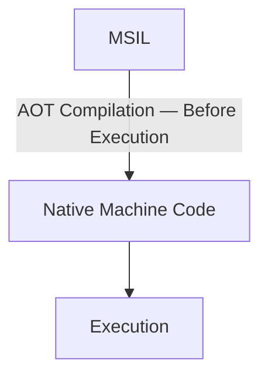

# 💻 Just-In-Time (JIT) Compiler

**JIT = Just-In-Time Compiler**

The JIT Compiler is an important component of the **CLR (Common Language Runtime)**.

Its main function is to **convert IL / MSIL into native machine code** — instructions that a computer's processor (CPU) can execute.

But why do we need JIT, and what is the difference between the three types mentioned in the lesson? Let's examine them in order.

---

## 1. Why Do We Need a JIT Compiler?

As we learned earlier, when you write a program in C# and build it, the C# Compiler usually does not convert your source code directly into machine code.

Instead, it first converts it into an intermediate language called **MSIL (Microsoft Intermediate Language)**.

When the program runs, the JIT Compiler converts the necessary MSIL instructions into native machine code.



Therefore, in the usual JIT execution path, there are **two compilation stages**:

1. **First compilation:** C# → MSIL, using the C# Compiler.
2. **Second compilation:** MSIL → Machine Code, using the JIT Compiler.

This is what the instructor means by compilation taking place in two stages.

---

## 2. What Are Explicit and Implicit Compilation?

The instructor mentions two terms:

**Explicit Compilation**

This means that the programmer explicitly requests a compiler to run, for example by clicking **Build** in Visual Studio.

**Implicit Compilation**

In the instructor's explanation, this refers to the second compilation step happening automatically during program execution through JIT, without the programmer explicitly invoking the JIT Compiler.

This is a simplified explanation of the idea, **not a formal or exhaustive classification** of every compilation method in .NET.

---

## 3. The Three JIT Types Mentioned in the Lesson

According to the instructor's slides, the three types are:

1. **Pre-JIT (AOT)**
2. **Econo JIT**
3. **Normal JIT (Default)**

> **Note:** This is a simplified historical classification. Modern .NET uses newer technologies and compilation strategies, which we will distinguish below.

### A. Pre-JIT Compiler (AOT)

**AOT = Ahead-of-Time Compilation**

The idea is to convert code into native machine code **before the program starts**, instead of waiting until execution time.

For example, if a program contains several methods, its native code can be prepared in advance.

The instructor mentions **`NGen.exe`**, a historical .NET Framework tool used to create native images ahead of time.



**Benefit:** Reducing compilation work at run time may improve program startup time.

**Important:** Pre-JIT and AOT are not literally types of just-in-time compilation, because compilation happens *ahead of time*. Also, the old **`NGen.exe`** technology is different from modern **Native AOT**.

### B. Econo JIT Compiler

**Econo** comes from *Economy*, referring to reducing resource usage, especially memory.

According to the simplified explanation in the slides:

- It compiles only the necessary parts of MSIL.
- It does not permanently retain all generated machine code.
- Compiled code may be discarded when it is no longer needed.
- If discarded code is needed again, it may have to be compiled again.

**Example:** Imagine the program calls a method named `Add()`.

Econo JIT compiles it, but may later discard its compiled code to save memory. If the program needs the method again *after* its compiled code has been discarded, it must be recompiled.

**Important:** Saying that Econo JIT "compiles on every call" is an oversimplification. Recompilation is needed when previously compiled code has been removed, **not necessarily every time the method is called**.

### C. Normal JIT Compiler (Default)

This is the usual JIT approach described by the instructor.

**It compiles methods when needed, then normally keeps the generated machine code in the process's memory for reuse.**

For example, consider this method:

```csharp
static int Add(int a, int b)
{
    return a + b;
}
```

Now call it three times:

```csharp
Console.WriteLine(Add(10, 20));
Console.WriteLine(Add(30, 40));
Console.WriteLine(Add(50, 60));
```

In the simplified Normal JIT model:

1. **First call:** JIT compiles `Add()` into machine code and executes it.
2. **Second call:** The program reuses the machine code already generated.
3. **Third call:** The program reuses the same compiled code again.

Therefore, the method does not have to be recompiled for every call.

| Call | What Happens |
|---|---|
| First Call | Compilation + Execution |
| Second Call | Reuse Compiled Code |
| Third Call | Reuse Compiled Code |

**Note:** Keeping compiled code here means keeping it in **process memory**, not necessarily in the CPU's hardware cache. In modern .NET, **Tiered Compilation** can recompile certain methods later to improve performance.

---

## 4. Comparing the Three Types

| Type | When Is Code Compiled? | Is Compiled Code Kept? |
|---|---|---|
| **Pre-JIT / AOT** | Before execution | Native code is prepared in advance |
| **Econo JIT** | At run time, as needed | May discard compiled code to save memory |
| **Normal JIT** | At run time, as needed | Usually kept for reuse |

---

## 5. Are These Types Still Used in Modern .NET?

The classification into **Pre-JIT**, **Econo JIT**, and **Normal JIT** comes from historical .NET explanations and technologies.

In modern .NET, important technologies include:

- **JIT / CoreCLR:** Compiles code at run time.
- **ReadyToRun (R2R):** Precompiles some code while still allowing JIT to be used.
- **Native AOT:** Compiles the application into native code before execution.

So, use the instructor's classification to understand the historical idea, but **do not treat these three names as the complete list of current compilers in every .NET version**.

---

## 🎯 Final Summary

The **JIT Compiler** is a CLR component that converts MSIL into native machine code during program execution.

To remember the three approaches from the lesson:

- **Pre-JIT (AOT):** Prepares machine code before the program runs.
- **Econo JIT:** Compiles required code and may discard compiled code to save memory.
- **Normal JIT:** Compiles code when needed and usually retains it for reuse.

**Remember the usual JIT compilation path:**

```text
C# → Compiler → MSIL → JIT → Machine Code → CPU
```

This is the usual JIT execution path. **AOT** prepares machine code before execution instead.

---

### 🌐 Translations

[](https://github.com/user-attachments/files/33628840/06_just_in_time_JIT_compiler_AR.pdf)
