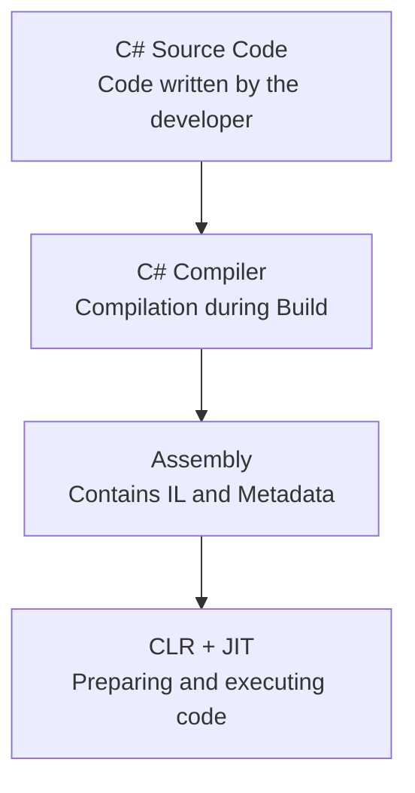
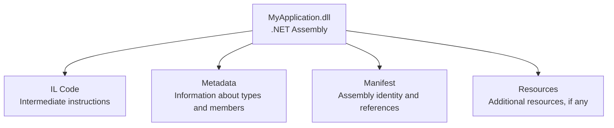
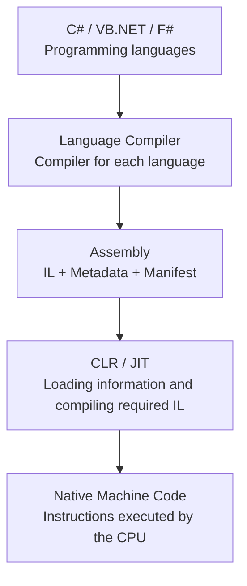

# 💻 Assemblies & Metadata (Manifest) in .NET

The lesson covers two important concepts in the architecture of **.NET**:

1. **Assemblies:** Files that contain a program after compilation.
2. **Metadata & Manifest:** Information that describes the program's contents and the assembly itself.

We will explain what an assembly is, its types, the difference between metadata and a manifest, and how they relate to the CLR.

---

## 1. What Is an Assembly?

The instructor says:

> An assembly is a fundamental unit of physical code grouping.

An **assembly** is a fundamental unit for grouping compiled program code in .NET.

Imagine you have written a C# project that contains several classes and methods. When you click **Build** in Visual Studio, the compiler translates your source code into **IL / MSIL** instructions and stores those instructions, together with descriptive information, in an assembly.



**In short:** An assembly is not the source code you write directly; it is a compiled program artifact created during the compilation process.

## 2. What Does an Assembly Contain?

A typical managed assembly contains components such as:



We will examine **Metadata** and **Manifest** in detail shortly.

---

## 3. What Are the Types of Assemblies?

The instructor mentions two main types:

- **Process Assembly:** Usually an `.exe` in the traditional .NET Framework model.
- **Library Assembly:** Usually a `.dll`.

### A. Process Assembly (.exe)

In the instructor's classification, this is an assembly that represents an executable application and contains an entry point such as `Main()`.

**Example:**

```csharp
class Program
{
    static void Main()
    {
        Console.WriteLine("Hello!");
    }
}
```

In the traditional **.NET Framework**, a Console Application project may produce a file such as `MyApp.exe`.

### B. Library Assembly (.dll)

A library assembly contains classes and methods that other applications can use.

For example, create a library with the following class:

```csharp
public class Calculator
{
    public int Add(int a, int b)
    {
        return a + b;
    }
}
```

After building the library project, you may get:

```text
Calculator.dll
```

Another project can add a reference to this library and use its `Calculator` class. You do not need to copy and rewrite the class in every project.

> **Note about modern .NET:** A `.dll` extension does not always mean that the file is merely a non-executable library. Some modern .NET applications run with `dotnet MyApp.dll`. Therefore, the EXE/DLL distinction in the slides represents the traditional simplified .NET Framework model.

---

## 4. What Does “Deployment Unit” Mean?

The instructor says:

> Assembly is a single unit of deployment.

**Deployment** means publishing an application or preparing it for use.

An assembly is a basic unit for identifying, distributing, and versioning code in .NET. For example, you can create a library named `Calculator.dll` and allow other applications to reference it.

However, **single unit** does not mean every complete application needs only one file. Applications may depend on other assemblies, libraries, and configuration files.

---

## 5. What Is Metadata?

The instructor says:

> Metadata is data that provides information about other data.

**Metadata** means data that describes other data.

Consider this example:

```csharp
public class Student
{
    public string Name { get; set; }

    public int Age { get; set; }

    public void PrintInfo()
    {
        Console.WriteLine(Name);
    }
}
```

When the compiler compiles the code, it creates information describing the program structure, including:

- The class name: `Student`.
- The `Name` property and its `string` type.
- The `Age` property and its `int` type.
- The `PrintInfo()` method.
- Accessibility information such as `public`.

This information is part of **Metadata**. The .NET runtime and tools such as **Reflection** use this information.

**In short:** Metadata describes the code's contents; it is not the instructions executed by the methods themselves.

## 6. What Is a Manifest?

The **Manifest** is a part of the assembly's metadata that describes the assembly's identity, components, and references.

It can contain information such as:

| Information | Meaning |
|---|---|
| **Assembly Name** | The assembly's name. |
| **Version Number** | The version of the assembly. |
| **Referenced Assemblies** | Other assemblies on which it depends. |
| **Files / Modules** | Files associated with the assembly, if any. |
| **Public Key / Signature** | Strong-name identity/signature information, when used. |

The broader metadata also contains information about classes, methods, properties, and available types.

> **Important clarification:** The instructor mentions a digital signature identifying the assembly's creator. Technically, an assembly can have a **strong name**, but a strong name alone does not verify the real-world identity of a publisher, and not every assembly must be strong-name signed.

## 7. What Is the Difference Between Metadata and Manifest?

| Metadata | Manifest |
|---|---|
| Describes classes, methods, fields, and types. | Describes the assembly's identity, version, references, and components. |
| Broader than the assembly identity information alone. | A specialized part of the assembly's metadata. |
| Example: A method named `Add()` exists. | Example: The assembly is named `Calculator`, with a particular version number. |

**Therefore:** Manifest is not another name for all metadata; it is a specific part of it.

---

## 8. How Do Assemblies, Metadata, and CLR Work Together?

The two slides showing the CLR execution model should now make more sense:



**Metadata** and **Manifest** help the runtime understand the code's structure and required references. **IL** contains the intermediate program instructions that the JIT can compile when needed.

---

## 🎯 Final Summary

Remember these definitions:

- **Assembly:** A unit that contains compiled code and its descriptive information in .NET.
- **EXE:** An executable file used to start an application in the traditional model.
- **DLL:** A file often used to provide reusable code and components.
- **Metadata:** Information describing types, classes, methods, and other elements.
- **Manifest:** Information identifying the assembly, its version, references, and components.

**C# → Compiler → Assembly (IL + Metadata) → CLR / JIT → Machine Code**

This is the main idea connecting the instructor's slides: after source code is compiled into IL, it is stored in an assembly together with information that helps .NET identify, load, and execute it.

---

### 🌐 Translations

[](https://github.com/user-attachments/files/33629489/07_assemblies_and_metadata_AR.pdf)
